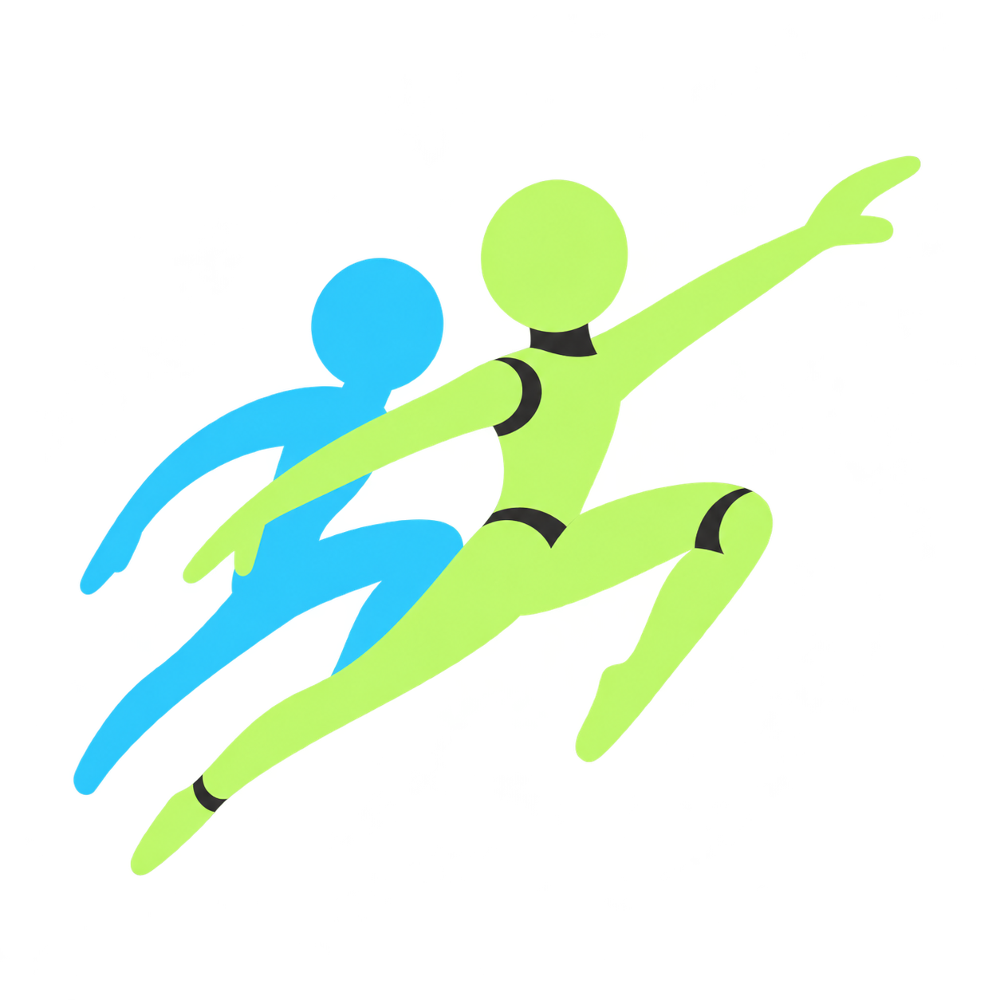

<p align="center">
  
</p>

# Motion Room

**A free, open-source studio for practicing 3D character animation.**

Study a reference, build your own animation from an empty timeline, or edit an imported motion. Motion Room brings the character, rig, reference and editing tools into one workspace so you can focus on posing, timing, spacing and body mechanics.

The application is **completely free to use**, with no account, subscription or paid features. Its original code is available under the [MIT License](LICENSE). The interface and documentation are in English.

[Get started](#getting-started) · [User guide](docs/USER_GUIDE.md) · [Contributing](#contributing) · [Licenses and credits](#license-and-credits)

## What you can do

| Tool | Use it to |
| --- | --- |
| Reference comparison | View your animation and a reference side by side, overlay them, or work solo. |
| Obstacle traversal studies | Edit a running vault, hands-free hurdle or mantle from the Game Animation Sample, with fitted obstacles and source travel. |
| Visible rigs | Select joints directly, including finger bones when available, and pose them with translation and rotation gizmos. |
| IK and contact pins | Move a hand or foot target to pose a limb, and hold contacts over a chosen frame range. |
| Joint channels and curves | Adjust individual joint timing and shape interpolation with smooth, linear, stepped or Bézier curves. |
| Key groups | Box-select or add keys with Ctrl/Cmd-click, copy, paste, duplicate, move and stretch a selection; zoom and scroll for precise timing. |
| Pose workshop | Enter numeric joint offsets, copy a joint or limb, mirror poses and reuse a personal pose library. |
| Reference board | Open a local video or image alongside the character; synchronize footage, set an offset and step source frames. |
| Ghost poses and trajectories | Inspect past and future poses, arcs and spacing. |
| Practice sessions | Loop an A–B section, hide the reference, save multiple takes, compare attempts and keep personal notes. |
| Scene objects | Add walls, stairs, ladders and other supports; position, rotate, resize and duplicate them with gizmos and grid snapping. |
| Animation editing | Import a rigged `.fbx` or `.glb` with animation and edit a copy of its motion. |
| Export | Download a baked animated `.glb`, optionally including scene objects, or record the viewport as a video. |
| Local projects | Keep work in your browser, duplicate projects, and recover deleted projects from Trash. |
| Portable projects | Save and reopen a `.motionroom` file containing editable work, original assets, reference footage, notes and saved takes. |

You choose how closely to follow a reference and when a take is finished. New practice takes start with **zero keys**. There are no scores, required poses or automatic assessments.

The library contains **16 studies**, including separate walk, run and sprint cycles. The three obstacle studies open with editable source motion, a fitted wall, hurdle or raised deck, and visible root travel. Camera views frame the complete animated take. Obstacle dimensions are editable; changing them does not automatically warp the source motion. See the [local traversal import workflow](tools/README.md) for provenance and regeneration.

## Getting started

### Requirements

- Node.js 22 or newer, with npm.
- A browser with WebGL support. Frame-by-frame WebM export requires WebCodecs with VP8 encoding; quick video uses `MediaRecorder` and canvas capture support.
- A mouse or trackpad for navigating the 3D viewport.

### Run locally

Clone this repository or download and extract its ZIP, then open a terminal in the project folder:

```sh
npm ci
npm start
```

Open [http://localhost:5173](http://localhost:5173) and keep the terminal running. Stop the server with **Ctrl+C**.

On Windows, you can instead double-click **[Start.cmd](Start.cmd)**. It installs the dependency if needed, starts the local server and opens the studio. Node.js must already be installed.

The app runs locally, with no cloud service or API key required. Installation needs an internet connection to download the npm dependency. Once dependencies and reference files are available locally, animation work can run offline. Third-party reference files have their own distribution terms; see [Licenses and credits](#license-and-credits).

## Your first animation

1. Choose a motion in **Practice**, or use **Import animation** to open an animated character.
2. Select a joint in the viewport or the **Pose** panel. Your working character uses the reference's model and skeleton.
3. Move the playhead and pose the character. **Auto key** records completed joint edits; switch it off to experiment, then press **K** when ready.
4. Open **Channels** or **Curves** to refine timing. In **Study**, enable ghost poses, trajectories or an A–B loop.
5. Save a take to compare attempts, or use **New animation** to work independently of a reference.
6. Choose **Export** to download the animation or record a video.

Use **Export → Save editable project (.motionroom)**, or **Ctrl/Cmd+S**, to keep an editable backup. Open it again with **Open project file** in the library. Drag the library and inspector edges or the advanced timeline's upper edge to resize panels; **Focus view** expands the 3D workspace.

For controls, contact workflows, reference settings and project management, see the [user guide](docs/USER_GUIDE.md).

## Build a scene for the motion

Use **Add object** above the viewport or **Scene → Open object library**. There are 13 procedural objects:

**Wall · Low wall · Stairs · Ladder · Box · Platform · Bench · Hurdle · Ramp · Doorway · Balance beam · Pole · Cylinder**

Select an object and use **W / E / R** to move, rotate or resize it. Optional snapping uses a 10 cm grid and 15-degree rotation steps. Numeric fields provide precise positions and dimensions; **Place on floor**, **Focus object** and **Duplicate** help with setup.

Scene objects are saved with projects and takes. They remain fixed during the animation and serve as contact guides; contacts are authored explicitly rather than generated by a physics simulation.

## File support

| Action | Format | Details |
| --- | --- | --- |
| Import an animation or reference | `.fbx`, `.glb` | Must include the rigged character and animation. Multi-clip sources are supported. |
| Export an animated character | `.glb` | Bakes source motion, authored keys and contact constraints at the project frame rate. Scene objects are optional. |
| Export a video | `.mp4` or `.webm` | Browser-dependent format; 720p or 1080p, at 30 or 60 fps. Records the full take, including when an A–B loop is active. |
| Save / open an editable project | `.motionroom` | Includes the original character and reference files, keys, curves, contacts, objects, notes, pose library, footage and saved takes. |
| Open a reference board | Browser-supported video or image | Local footage and pose sheets; embedded in portable projects. |

**Frame-by-frame video** writes a WebM with an explicit timestamp for every frame. **Quick video** records in real time in the browser's supported MP4 or WebM format. Both export the full take. GLB and frame-by-frame video show progress and support cancellation; quick recording can also be cancelled. The video/image reference board stays outside the captured 3D canvas.

Import self-contained files: embed FBX textures and GLB buffers/textures. Standalone character import and FBX export are not available. Skeleton overlays, gizmos, ghost poses and trajectories are excluded from GLB exports.

Exported reference models and motion remain subject to their original asset licenses. Motion Room's MIT license does not grant additional rights to imported or third-party content.

## Projects and privacy

The local app processes imported files in your browser and stores projects with IndexedDB and a local edit journal. It has no account system, upload service, analytics or cloud synchronization.

Use the same browser profile and local address to reopen browser saves: `localhost` and `127.0.0.1` have separate storage. Clearing browser site data can remove projects. Save a **`.motionroom` project** to keep editable work outside the browser. A GLB contains the baked animation; a portable project also retains the authoring data, notes and saved takes. The session's Undo/Redo stack is not part of the portable file.

The header distinguishes **Saving…**, **Saved locally** and **Save failed**. Failed writes remain queued for **Retry save**. Export also shows storage usage and, where supported, a **Protect browser saves** control. A portable file remains useful even when browser storage is unavailable.

Deleted projects go to **Trash**, where they can be restored. **Undo** is also available immediately after deletion.

## Keyboard shortcuts

| Shortcut | Action |
| --- | --- |
| Space | Play / pause |
| Left / right arrow | Previous / next frame |
| W / E / R | Move / rotate / scale the selected scene object or whole character; joints support move and rotate |
| K | Key the current pose |
| Delete | Delete the selected object or the selected joint/pose key at the playhead |
| Ctrl/Cmd + Z | Undo |
| Ctrl/Cmd + Shift + Z | Redo |
| Ctrl/Cmd + S | Download an editable `.motionroom` project |
| Ctrl/Cmd + C / V | Copy / paste selected keys while the advanced timeline is open |
| Ctrl/Cmd + D | Duplicate selected keys in the advanced timeline, or duplicate a selected scene object |
| Shift + left / right arrow | Nudge selected keys by one frame |
| F | Frame the scene |
| Shift + F | Focus the selected joint or object |
| 0 / 1 / 3 / 7 | Perspective / front / side / back view |

## Development

Motion Room uses JavaScript modules, HTML, CSS and [Three.js](https://threejs.org/). A small Node.js server serves the files locally; there is no build step or application backend.

```sh
npm ci
npm test
npm run dev
```

Browser regression checks use a temporary browser profile. With the local server running, install the test browser once and run:

```sh
npx playwright install chromium
npm run test:browser
```

See [testing notes](docs/TESTING.md) for covered workflows and fixtures.

| Location | Purpose |
| --- | --- |
| `src/main.js` | Workspace, projects, imports, undo and exports |
| `src/stage.js`, `src/rig-overlay.js` | 3D scene, comparison views, skeletons and gizmos |
| `src/animation-editor.js`, `src/pose-keys.js` | Pose evaluation, source-motion corrections and baked export |
| `src/joint-tracks.js`, `src/joint-timeline.js` | Independent joint tracks and curve editing |
| `src/ik.js` | Limb solving and contact constraints |
| `src/scene-objects.js` | Procedural obstacle library and scene-object export |
| `src/studio-tools.js`, `src/motion-analysis.js` | Tool panels, practice sessions, ghost poses and trajectories |
| `src/reference.js`, `src/reference-catalog.js` | Reference loading, source credits and library entries |
| `src/reference-store.js`, `src/take-journal.js` | Browser persistence and reload recovery |
| `src/persistence.js`, `src/project-file.js`, `src/project-manager.js` | Serialized autosaves, portable project container and project library |
| `src/edit-history.js`, `src/timeline-edit.js` | Clip-aware undo and atomic edits to key groups |
| `src/pose-tools.js`, `src/media-reference.js`, `src/workspace-layout.js` | Pose library, synchronized footage and adjustable panels |
| `src/workspace-exports.js`, `src/webm-writer.js` | Cancellable exports and timestamped, seekable WebM video |
| `tests/` | Import, posing, IK, contacts, timing, geometry, export and compatibility checks |

Some tests load reference assets from this workspace, including the archived mannequin. The full suite requires those fixtures; their licenses are listed in [Third-party notices](THIRD_PARTY_NOTICES.md).

## Product video

An English product trailer and social cuts are built with React / Remotion in [`video/`](video/README.md). The production project includes real application captures, an original score, a YouTube thumbnail and English publishing copy. Its dependencies are isolated from the studio application.

See the [video production guide](video/README.md) to preview or render the 16:9 YouTube, 4:5 X and 9:16 Shorts versions.

## Contributing

Bug reports, documentation improvements and pull requests are welcome. For a bug report, include the browser, operating system, reproduction steps and a screenshot or sample file you have permission to share.

For code changes, describe the resulting behavior and run `npm test` when relevant. Include a viewport screenshot for visual changes. Keep user-facing text in English and preserve source credits when changing reference assets.

Contributions to the project's original code and documentation use the MIT License. New models, animations and textures need an explicit license that permits the intended distribution, with their provenance and attribution recorded in [Third-party notices](THIRD_PARTY_NOTICES.md).

## License and credits

Motion Room is **free to use**. Its original source code, documentation and project artwork are released under the **[MIT License](LICENSE)**, which permits use, modification and redistribution, including commercial use, subject to its notice requirements.

Third-party dependencies, characters and animations retain their own licenses. They are **not relicensed under MIT**. See **[Third-party notices](THIRD_PARTY_NOTICES.md)** for sources, adaptations, attribution and redistribution terms.

The development workspace includes Epic Games sample files and a Mixamo FBX. These raw assets need to be excluded or replaced with redistributable alternatives before a public source release unless separate permission covers their distribution. A free download and an MIT license for the application do not override the asset providers' terms.

Thanks to the Three.js authors, Mesh2Motion, ACCAD / The Ohio State University, Quaternius, KinemIQ, Epic Games, Mixamo and SketchPunk for the tools and reference material used during development. Motion Room is an independent project and is not affiliated with these providers.
